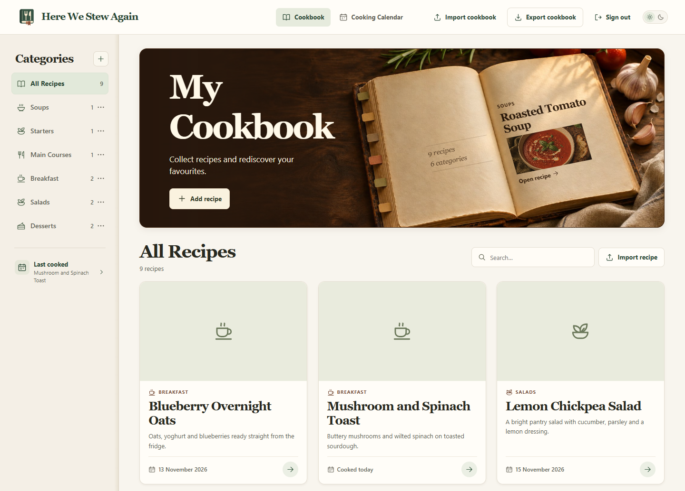
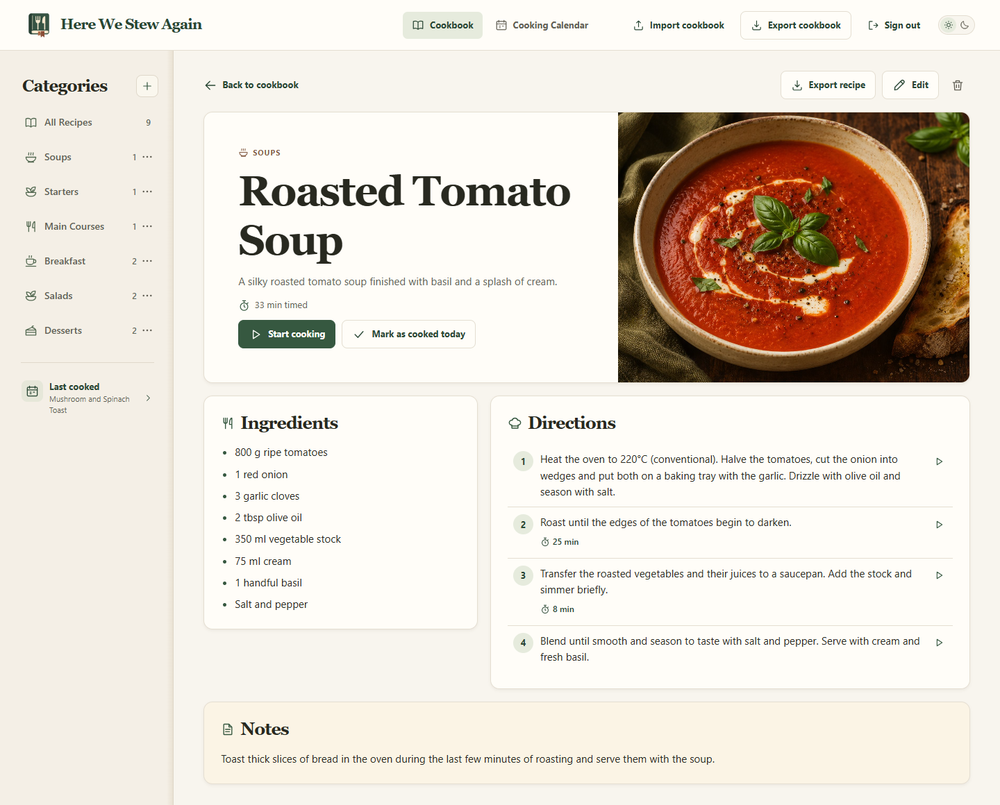
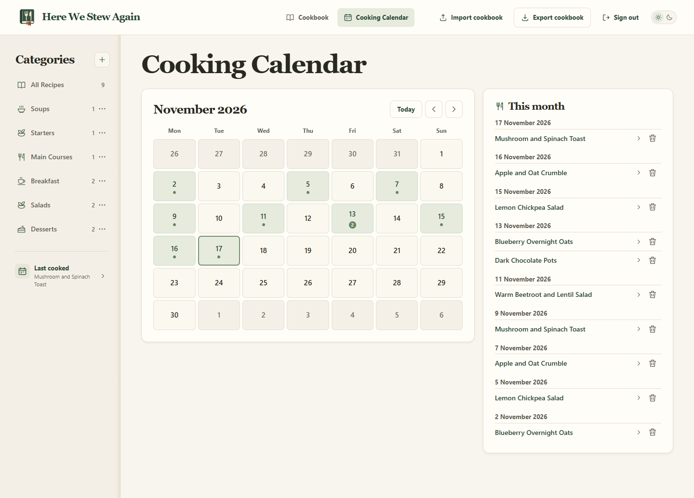

# Here We Stew Again

A self-hosted cookbook for collecting recipes, cooking step by step and keeping track of what you made.

Here We Stew Again exists to make it easy to share recipes from a cookbook you host yourself. The app is free to use with your own computing and storage resources. Today, you can share a recipe as a JSON file that includes all its photos and can be imported into another cookbook. The plan is to let instances exchange recipes directly and help the people running them connect with one another.



The screenshots show the three built-in starter recipes and the [example cookbook](examples/example-cookbook.json) imported with **Merge**.

## Getting started

### Run with Docker

From the project directory, run:

```sh
docker compose up --build -d
```

Open [http://localhost:3000](http://localhost:3000). The container is named `herewestewagain`.

```sh
docker compose logs -f cookbook
docker compose down
```

If you are upgrading from `herewestewagain-cookbook-1`, run `docker compose up --build -d` with the same Compose project name to recreate the container using your existing data volume. If you move to a new checkout directory, use `docker compose -p herewestewagain up --build -d` to keep using the `herewestewagain` project's volume. [Compose project names](https://docs.docker.com/compose/how-tos/project-name/)

### Run with Node.js

Use Node.js 24 or newer. The app uses Node's built-in SQLite module and has no npm dependencies.

```sh
npm start
```

Open [http://localhost:3000](http://localhost:3000). Use `npm run dev` to restart the server automatically when source files change.

### Sign in for the first time

1. Open the app on `localhost` and sign in as `steward` with the password `cooksagain`.
2. Choose your username and a new password, then select **Save and open cookbook**.
3. Use your saved credentials for future sign-ins.

Complete setup before allowing access from other devices. Use HTTPS through a reverse proxy when making the app available over the internet.

Each installation has one shared account. The password is stored as a salted hash in SQLite. A session ends when you sign out, after 12 hours or when the server restarts.

### Recover a forgotten username or password

Someone with command-line access to the installation can create a temporary recovery account. The command prints a randomly generated username and password. The recovery account is created only when you run this command.

For the running Docker container, use either command.

```sh
docker exec herewestewagain node recovery.mjs
```

```sh
docker compose exec cookbook node recovery.mjs
```

For a Node.js installation, run the following in the project directory with the same `DATA_DIR` environment setting as the app.

```sh
npm run recovery:create
```

1. Copy the generated username and password from the terminal.
2. Open the app's usual sign-in page. Sign out of an existing session if needed, then sign in with the recovery credentials.
3. Enter the username and password you want for the regular shared account and save them.

The recovery account can open the credential reset screen. Saving the new credentials removes the recovery account and ends all previous sessions. You can then use the newly saved credentials to sign in. Creating a recovery account leaves the regular account usable while recovery is pending.

There is at most one recovery account per installation. Running the command again replaces its credentials and immediately invalidates its earlier reset sessions. Recovery credentials remain valid across app restarts until a successful reset or another creation command. A browser reset session lasts 15 minutes and ends on restart. If that session expires, sign in again with the current recovery credentials.

The command requires an existing cookbook with a configured account. The recovery password is stored as a salted hash in the same SQLite database as the regular account. Full data-directory backups also include a pending recovery account. JSON recipe and cookbook exports contain cookbook content.

## Data storage

The SQLite database `kochbuch.sqlite` contains your recipes, categories, uploaded photos, cooking history and shared sign-in account.

| How you run the app | Database location |
| --- | --- |
| Docker Compose | `/app/data/kochbuch.sqlite` inside the `herewestewagain` container. Docker stores `/app/data` in the named volume `kochbuch-daten`, whose Docker name is `herewestewagain_kochbuch-daten` for the `herewestewagain` Compose project. |
| Node.js | `data/kochbuch.sqlite` in the project directory by default. Set `DATA_DIR` to use a different directory. |

Run `docker inspect --format '{{json .Mounts}}' herewestewagain` to find the volume name and its location as seen by Docker. On Docker Desktop running Linux containers, this location is inside Docker Desktop's Linux backend. The volume persists when the container stops or is rebuilt, and after `docker compose down`. Running `docker compose down -v` deletes the volume and its data. [Docker volumes](https://docs.docker.com/engine/storage/volumes/) · [Compose down](https://docs.docker.com/reference/cli/docker/compose/down/)

## Using the cookbook

- **Find recipes.** Search titles, descriptions, ingredients and notes or browse by category. The open book on the home page links to a randomly featured recipe.
- **Sort recipes.** Sort by last cooked date or cooking time in either direction, by name or by your star rating. Cooking time adds up the timed steps. Recipes without a cooking date, timer or rating go last when you sort by that field.
- **Organise your recipes.** Create categories from the sidebar or while editing a recipe. Assign each category an icon. Deleting a category moves its recipes to **Uncategorized**.
- **Write and illustrate recipes.** Add ingredients, directions, notes and up to 12 photos. Select several photos at once or add them in batches. The first photo is the cover. Supported formats are JPEG, PNG, GIF, WebP and AVIF. Press Enter in the ingredient list to move to the next item or add a new line.
- **Add your own rating and difficulty.** Set or clear a rating directly on the recipe page. Choose Easy, Medium or Hard when editing the recipe. Both fields are optional.
- **Cook step by step.** Choose **Start cooking** or click a specific step in the directions. Steps with a duration show a countdown and a finish time. You can pause or restart a timer and jump to another step.
- **Keep a cooking history.** Choose **Mark as cooked today** to add the recipe to the calendar. Click a calendar day to see the dishes you logged, or use the monthly list to reopen a recipe or remove an entry.
- **Switch themes.** Use the dark mode switch in the top bar. Your browser remembers the selection.





## Example recipes and cookbook

A new database starts with **Roasted Tomato Soup**, **Burrata with Roasted Tomatoes** and **Lemon and Herb Pasta**. The following files in [`examples/`](examples/) are additional example data for trying the import tools. Each example recipe includes an embedded cover photo, both in the individual file and in the complete example cookbook.

An existing database keeps its saved recipe text and category names when you upgrade to the English interface.

### Import example recipes

Download one or more JSON files below. Choose **Import recipes** and select all the files you want to upload. **Target category** defaults to the category you are viewing, or **No category** on **All Recipes**. Choose the destination and select **Import**. Recipes that import successfully are saved even if another file in the selection fails.

| Category | Example recipe files |
| --- | --- |
| Breakfast | [Blueberry Overnight Oats](examples/recipes/breakfast/blueberry-overnight-oats.json), [Mushroom and Spinach Toast](examples/recipes/breakfast/mushroom-and-spinach-toast.json) |
| Salads | [Lemon Chickpea Salad](examples/recipes/salads/lemon-chickpea-salad.json), [Warm Beetroot and Lentil Salad](examples/recipes/salads/warm-beetroot-and-lentil-salad.json) |
| Desserts | [Apple and Oat Crumble](examples/recipes/desserts/apple-and-oat-crumble.json), [Dark Chocolate Pots](examples/recipes/desserts/dark-chocolate-pots.json) |

### Import the example cookbook with calendar entries

1. Download [`example-cookbook.json`](examples/example-cookbook.json). It contains all six example recipes in three categories, plus ten cooking entries.
2. Choose **Import cookbook**, select the file and leave **Merge** selected to add the examples to your current cookbook.
3. Open **Cooking Calendar** and navigate to **November 2026** to see the entries shown in the screenshot.

## Back up, restore and share

| Action | What it does |
| --- | --- |
| **Export cookbook** | Downloads a JSON backup of categories, recipes, embedded photos and cooking history. |
| **Import cookbook → Merge** | Adds recipes and cooking entries to the current cookbook. It keeps recipes with matching IDs and matches categories by ID or name. Each recipe is logged once per date. |
| **Import cookbook → Restore** | Replaces the current categories, recipes, photos and cooking history. Export your current cookbook first if you want to keep a copy. |
| **Export recipe** | Downloads one JSON file with the recipe, category, difficulty, rating and all saved photos. |
| **Import recipes** | Adds one or more recipe files to your selected category. Reimporting a changed version saves it as a separate recipe. |

Photo data is embedded in the exported JSON. Import the file to recover the cover and the rest of the gallery in order. Use **Import cookbook** to bring in categories from a backup.

JSON backups contain cookbook content. For a full backup that includes the shared account, stop the app and copy its entire [data directory](#data-storage). With Docker Compose, you can copy the stopped container's data to a directory outside the source checkout. [Docker copy](https://docs.docker.com/reference/cli/docker/container/cp/)

```sh
docker compose stop cookbook
docker cp herewestewagain:/app/data/. ../herewestewagain-backup
docker compose start cookbook
```

## Configuration

For Docker Compose, put settings in a `.env` file beside `compose.yaml`. When running with Node.js, set them in the server process environment.

| Setting | Applies to | Default | Purpose |
| --- | --- | --- | --- |
| `COOKBOOK_BIND_IP` | Docker Compose | `127.0.0.1` | Set to `0.0.0.0` to reach the app over your local network using the Docker host's IP address. |
| `COOKBOOK_PORT` | Docker Compose | `3000` | Port published on the host. |
| `HOST`, `PORT` | Node.js | `127.0.0.1`, `3000` | Server bind address and port. |
| `DATA_DIR` | Node.js | `data` in the project directory | Directory that holds `kochbuch.sqlite`. Run one server process per data directory. |
| `MAX_IMAGE_BYTES` | Both | `8388608` (8 MiB) | Maximum size per photo, in bytes. You can raise it to 24 MiB. |
| `MAX_IMPORT_BYTES` | Both | `268435456` (256 MiB) | Maximum size of a JSON import, in bytes. You can raise it to 500 MiB. |
| `SECURE_COOKIES` | Both | Off | Set to `1` when serving the app over HTTPS through a reverse proxy to restrict the session cookie to HTTPS. |

## Tests

```sh
npm test
```

The suite uses temporary SQLite databases and local HTTP servers. It covers account setup, session expiry and login throttling, recovery, protected endpoints, database upgrades, recipe and category changes, image ownership and deletion, failed-edit rollback, JSON validation and size limits, imports and exports including photo bytes, cooking history, recipe sorting and editor regressions.

To see coverage for the modules exercised by the tests, run:

```sh
npm run test:coverage
```

Coverage includes the server subprocesses. Browser interactions and visual layout still need browser testing; the Node.js suite does not exercise every frontend interaction.

## License

This project, including the bundled examples and artwork, is released under the [MIT License](LICENSE). The recipe and background artwork was generated with AI for this project.
